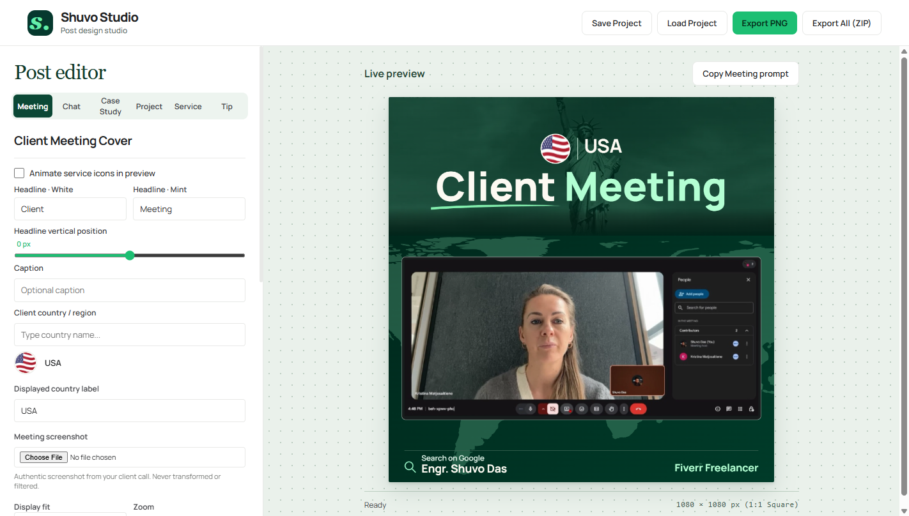
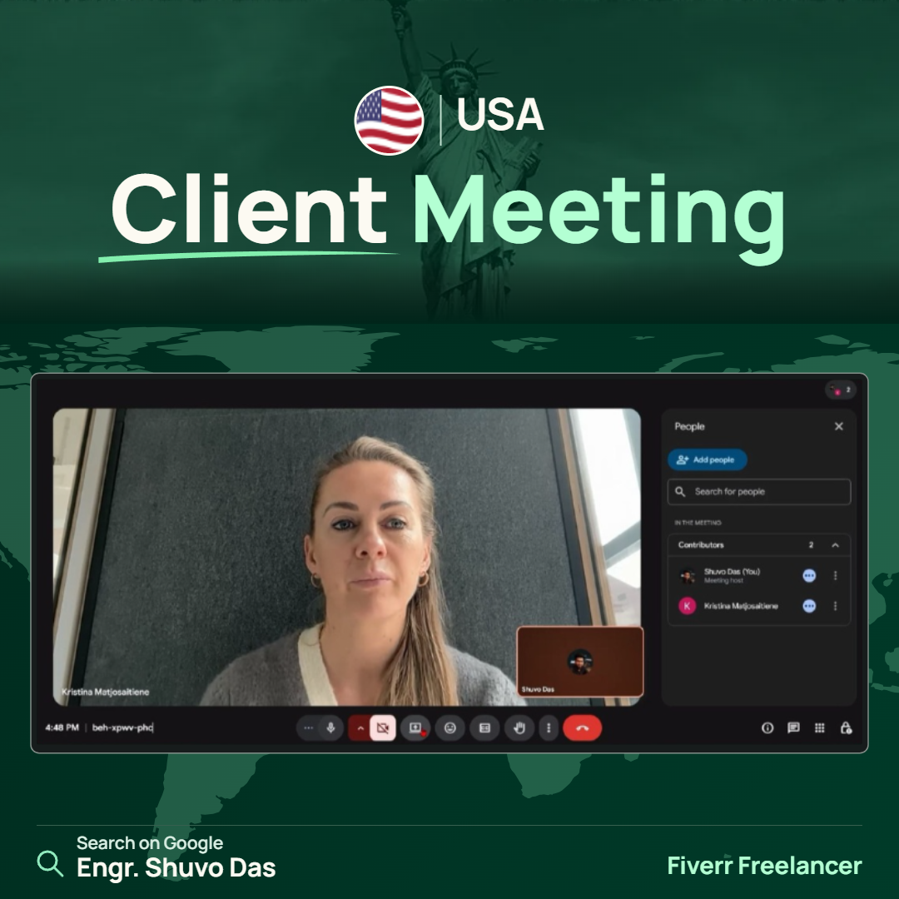

# Client Meeting Post Generator

Shuvo Studio is a browser-based editor for creating branded social posts from client meetings, chats, projects, and reviews. Choose a country, add your screenshot, and export a post with a matching landmark photograph, green color palette, and author footer.

## Run locally

Download or clone the repository, keep its folders together, and open [index.html](index.html) in a modern browser. The editor runs directly from the file without an installation or build step.

## Make a post

1. Choose a template. New sessions start in **1:1 square (1080 × 1080)**. To make a portrait post, change **Canvas aspect ratio** under **Brand & Canvas Settings**.
2. Fill in the template fields. For a Meeting or Chat headline, put the opening words in **Headline · White** and the words to emphasize in **Headline · Mint**.
3. For Meeting, select the client’s country and upload a call screenshot. For Chat, select the country, upload a conversation screenshot, and choose a phone or monitor frame. The round flag and landmark background follow the selected country.
4. Click the post preview to inspect it full-screen. Choose **Export PNG** for the current post or **Export All (ZIP)** for one PNG of each of the six templates.

## Templates

| Template | Content |
| --- | --- |
| Meeting | Country, meeting headline, optional caption, and a screenshot in a monitor frame |
| Chat | A conversation, order confirmation, or review screenshot in a phone or monitor frame |
| Case Study | A project headline followed by the client’s challenge and the solution |
| Project | A project screenshot, description, and technology list |
| Service | A service overview with three benefits or deliverables |
| Tip | A practical takeaway and a short explanation |

## Reuse a design

- **Save Project** downloads a JSON file containing the editable settings and screenshots. Use **Load Project** to continue editing it later.
- **Text size** adjusts the active template independently. Use **Headline vertical position** in Meeting or Chat to fine-tune the title placement.
- **Copy prompt** copies a writing prompt for the active template. Paste it into the AI conversation that already contains your client notes, then copy the returned text into the matching fields.

## Example export

This square PNG was exported from the Meeting template using the bundled sample screenshot.

